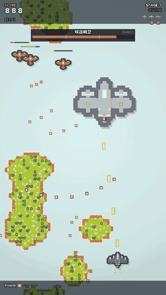
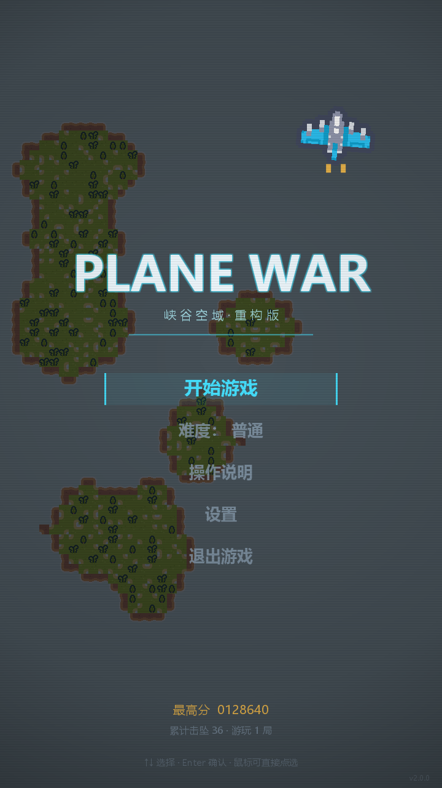
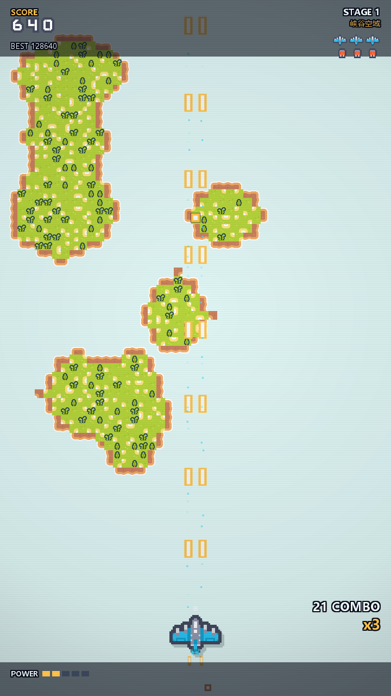
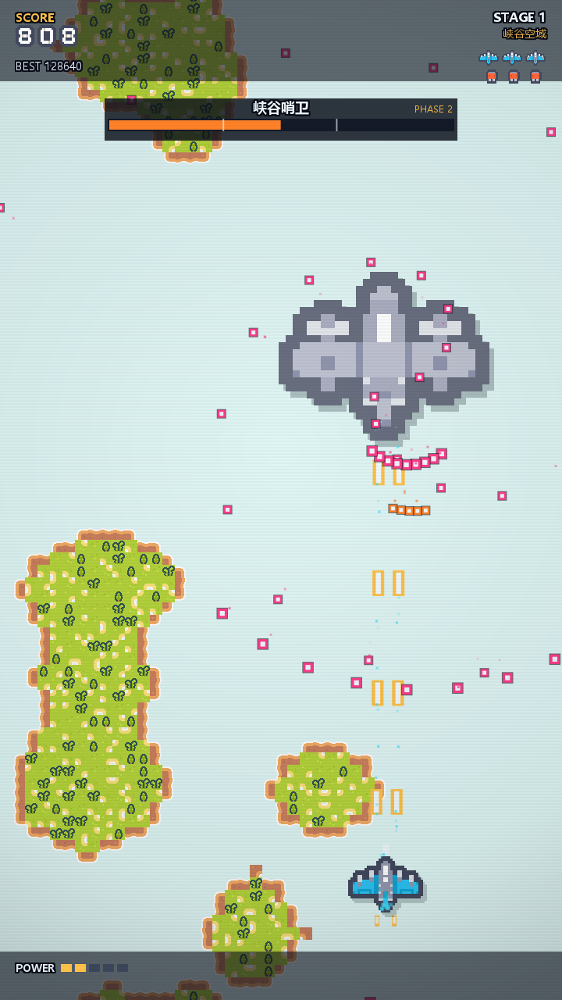
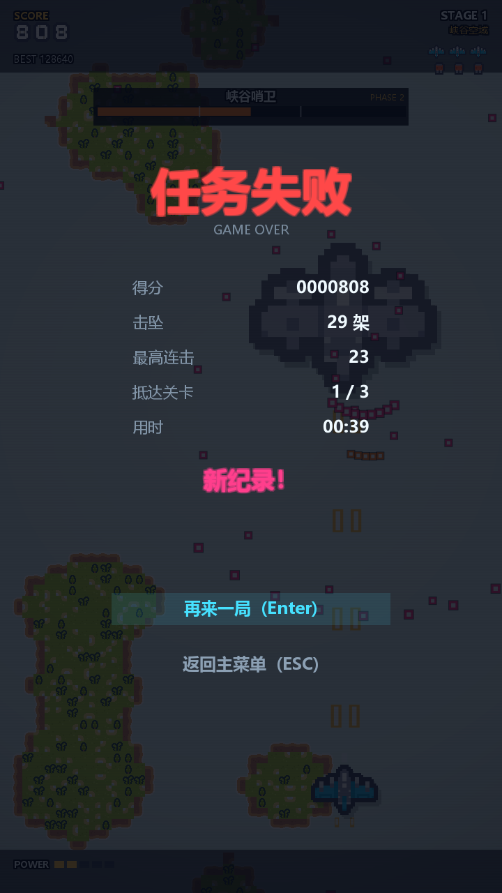

<div align="center">

# 🛩️ PlaneWar

**像素风纵版弹幕射击小游戏**



</div>

一款街机风格的纵版弹幕射击游戏。三关三个多阶段 Boss、五类敌机、五种道具、连击倍率，
音效和 BGM 全部由代码实时合成，不依赖任何游戏引擎。

## ✨ 特性

- 🎯 **三关三 Boss**：血量降到 2/3、1/3 时切换阶段，从扇形弹幕升级到螺旋、弹幕雨、召唤无人机
- 👾 **五类敌机**：侦察机、战斗机、重装机、精英机、无人机，各有独立路线和开火逻辑
- 🔥 **连击倍率**：最高 x8，断连归零；五种道具（火力 / 护盾 / 炸弹 / 修复 / 双倍得分）
- 💥 **打击感**：方点粒子、震屏、顿帧、闪白、Boss 出场警告
- 🖼️ **像素美术**：飞机、地形、UI 来自 Kenney Pixel Shmup（CC0），风格统一
- 🎧 **程序化音频**：14 种音效 + 3 轨 BGM 现场合成，没有音频文件

## 📸 画面

<p align="center">
  
  
  
  
</p>

## 🎮 操作

`WASD` / 方向键 / 鼠标移动 · `Shift` 精确减速 · 自动开火 · `X` / `K` 炸弹 · `Esc` / `P` 暂停

机体 3 条命，被击落降一级火力；护盾可顶一次伤害；炸弹清屏并对范围内敌人造成大量伤害。

## 🚀 运行

**方式一：下载即玩（Windows）**

到 [Releases](https://github.com/K4-23/PlaneWar/releases) 下载 `PlaneWar-Windows.zip`，解压后双击 `PlaneWar.exe`，不需要装 Java。

**方式二：从源码构建**

```bash
mvn clean package
java -jar target/plane-war-2.0.0.jar
```

需要 JDK 17+ 和 Maven 3.8+。也可以直接跑 `run.bat` 或 `build.ps1 -Run`。

## 🗂️ 工程结构

```
src/main/java/com/k423/planewar
├─ core/    常量、难度、输入、场景栈、随机数
├─ entity/  玩家、敌机、Boss、子弹、道具、World
├─ ai/      关卡刷怪调度、弹幕形状
├─ vfx/     粒子、震屏、飘字
├─ gfx/     渲染器、像素素材、字体、配色
├─ audio/   音效烘焙、音乐音序器、混音
├─ ui/ scene/ data/   HUD、主菜单与战斗场景、本地存档
└─ Main / GameWindow / GamePanel   入口与固定步长主循环
```

## 🧠 技术点

- **固定步长**：逻辑固定 1/60 秒一步，渲染与逻辑解耦，卡顿时最多补算 5 步
- **像素渲染**：逻辑分辨率 720×1280，最近邻插值 + 整数倍缩放；地形用 16×16 瓦片拼成无缝滚动地图
- **对象池**：子弹、敌弹、爆炸、粒子全部复用，长时间游玩不产生 GC 抖动
- **程序化音频**：启动时把音效烘焙成 16bit PCM，BGM 由音序器实时演奏，无声卡自动静默

```bash
mvn test    # 18 个用例：碰撞、连击、存档、Boss 阶段、整局模拟
```

## 🙏 致谢

美术素材：[Kenney](https://kenney.nl) 的 [Pixel Shmup](https://kenney.nl/assets/pixel-shmup)（CC0 1.0）

## 📄 许可证

[MIT](LICENSE) © 2026 K4-23
